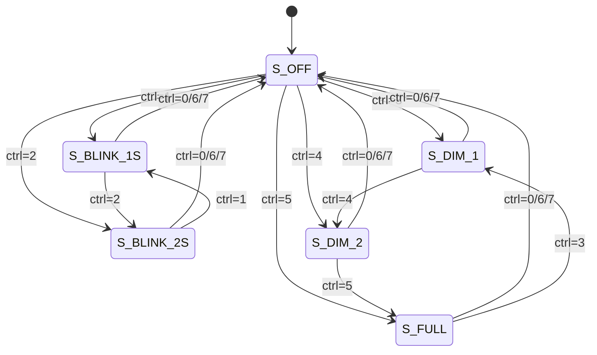

# Led_Shell 设计说明

对应 PG002 规培任务 1.2 节（PS-PL 简单 LED 驱动）。本文件覆盖 PG001
Verilog 篇要求的「模块描述、状态转移图、Testbench」，以及时序计算和验证记录。

## 1. 模块划分

| 文件 / 模块 | 层次 | 功能 |
| --- | --- | --- |
| `src/led_driver.v` / `Led_Driver` | PL | 6 状态状态机 + 1 kHz PWM + 闪烁，输出 LED |
| `src/led_shell_top.v` / `Led_Shell_Top` | PL 顶层 | 例化 Block Design 的 PS wrapper + `Led_Driver` |
| `src/led_shell.xdc` | 约束 | LED 引脚 W14、LVCMOS33、CFGBVS |
| `Led_Shell.srcs/.../led_shell_bd.bd` | PS | PS7（DDR3 / UART1 / FCLK 50 MHz / M_AXI_GP0）+ AXI GPIO + AXI Interconnect + proc_sys_reset |
| `Led_Shell.sdk/led_shell/src/main.c` | PS | 串口 shell 主循环（开机打印 Hello World + 横幅） |
| 同目录 `cmd.c/.h` | PS | 命令表与命令解析（help / hello / led / status） |
| 同目录 `uart.c/.h` | PS | UART1 轮询收发 |
| 同目录 `led.c/.h` | PS | 写 AXI GPIO 控制字 |
| 同目录 `helloworld.c/.h` | PS | 前置任务 Hello World 输出 |
| `tb/tb_led_driver.v` | 仿真 | 自检测试平台（覆盖 6 种模式） |

## 2. 系统框图

```text
 PC 串口 115200 8N1
        |
        v
 +--------------------- PS (ARM Cortex-A9) ----------------------+
 |  UART1 (MIO24/25)                                             |
 |    -> main.c 行缓冲 -> cmd.c 命令表 -> led.c                  |
 |    -> AXI GPIO 输出寄存器 (0x41200000)                        |
 +-------------------------------|--------------------------------+
                                 | AXI Interconnect (AXI3 -> AXI-Lite)
                                 v
 +--------------------- PL (Artix-7) -----------------------------+
 |  AXI GPIO (4 bit all outputs) -> ctrl[3:0]                     |
 |  Led_Driver : 状态机 + 1 kHz PWM + 闪烁计数                    |
 |      -> led (W14, 低电平点亮)                                  |
 +----------------------------------------------------------------+
```

## 3. 控制字

`ctrl[3:0]` 由 PS 写入 AXI GPIO，`ctrl[2:0]` 选择动作，`ctrl[3]` 保留：

| `ctrl[2:0]` | 状态 | 说明 |
| --- | --- | --- |
| 0 | `S_OFF` | 熄灭 |
| 1 | `S_BLINK_1S` | 1 s 周期闪烁（亮 0.5 s / 灭 0.5 s） |
| 2 | `S_BLINK_2S` | 2 s 周期闪烁（亮 1 s / 灭 1 s） |
| 3 | `S_DIM_1` | PWM 常亮，亮度 1 档（33 %） |
| 4 | `S_DIM_2` | PWM 常亮，亮度 2 档（67 %） |
| 5 | `S_FULL` | PWM 常亮，亮度 3 档（100 %） |
| 6, 7 | - | 保留，按熄灭处理 |

## 4. 状态机



| 状态 | 输出 | 计数器 |
| --- | --- | --- |
| `S_OFF` | 0 | 闪烁计数器清零 |
| `S_BLINK_1S` | `blink_phase` | 半周期 `CLK_HZ/2` = 25 000 000 |
| `S_BLINK_2S` | `blink_phase` | 半周期 `CLK_HZ` = 50 000 000 |
| `S_DIM_1` | `pwm_cnt < 16 666` | PWM 计数器 0~49 999 |
| `S_DIM_2` | `pwm_cnt < 33 333` | PWM 计数器 0~49 999 |
| `S_FULL` | `pwm_cnt < 50 000`（恒 1） | PWM 计数器 0~49 999 |

实现要点：

1. **控制字打一拍**：`ctrl_r <= ctrl`，避免 PS 异步写寄存器造成亚稳态；
2. **状态切换复位相位**：`state_changed` 时 `blink_cnt` 清零、`blink_phase` 置 1，
   保证每次换模式都从「亮」开始；
3. **输出取反**：板载 LED 低电平点亮，`assign led = LED_ACTIVE_LOW ? ~led_on : led_on`，
   换高电平点亮的板子只改参数即可；
4. 输出级为寄存器/简单比较，无组合逻辑环路。

## 5. 时序与参数计算

| 参数 | 计算 | 数值 |
| --- | --- | --- |
| 输入时钟 | PS `FCLK_CLK0` | 50 MHz（20 ns） |
| PWM 周期 | `CLK_HZ / PWM_HZ` = 50 000 000 / 1 000 | 50 000 个时钟 |
| PWM 频率 | 50 MHz / 50 000 | 1 kHz |
| 亮度 1 档 | `PWM_PERIOD / 3` | 16 666（33.3 %） |
| 亮度 2 档 | `PWM_PERIOD * 2 / 3` | 33 333（66.7 %） |
| 亮度 3 档 | `PWM_PERIOD` | 50 000（100 %） |
| 1 s 闪烁半周期 | `CLK_HZ / 2` | 25 000 000（0.5 s） |
| 2 s 闪烁半周期 | `CLK_HZ` | 50 000 000（1.0 s） |

## 6. PS 端程序结构

| 文件 | 主要函数 | 说明 |
| --- | --- | --- |
| `main.c` | `main` / `Main_Prompt` | 初始化、行缓冲、回车执行命令 |
| `cmd.c` | `Cmd_Execute` / `Cmd_Help` / `Cmd_Hello` / `Cmd_Led` / `Cmd_Status` | 空格切分 + 命令表查找 |
| `uart.c` | `Uart_Init` / `Uart_PutChar` / `Uart_PutString` / `Uart_GetChar` | XUartPs 轮询方式 |
| `led.c` | `Led_SetMode` / `Led_GetMode` | 写 `LED_CTRL_REG`（`XPAR_AXI_GPIO_0_BASEADDR`） |
| `helloworld.c` | `Hello_World_Print` | 前置任务输出 |
| `platform.c` | `init_platform` / `cleanup_platform` | 板级初始化钩子 |

命令处理流程：`UART 中断/轮询 -> 行缓冲 -> 回车 -> Cmd_Execute -> 命令表 ->
handler -> Led_SetMode -> AXI GPIO`。

## 7. 验证

### 7.1 Testbench 覆盖

`tb/tb_led_driver.v` 把 `CLK_HZ`/`PWM_HZ` 缩小到 100/1（只依赖比例，不影响逻辑），
自检以下内容：

| 用例 | 检查点 | 期望 |
| --- | --- | --- |
| mode 0 | 200 个时钟内 LED 一直为 0 | 通过 |
| mode 1 | 闪烁高/低电平宽度 | 50 / 50 时钟（±2） |
| mode 2 | 闪烁高/低电平宽度 | 100 / 100 时钟（±2） |
| mode 3 | 100 个时钟内高电平数 | 33（±2） |
| mode 4 | 100 个时钟内高电平数 | 66（±2） |
| mode 5 | 100 个时钟内高电平数 | 100 |
| mode 6（保留） | LED 一直为 0 | 通过 |

### 7.2 仿真结果

运行 `scripts\run_sim.cmd`，实测输出保存在 `docs/sim_result.txt`：

```text
PASS : mode0 high clocks = 0
PASS : mode1 blink high = 49
PASS : mode1 blink low = 50
PASS : mode2 blink high = 99
PASS : mode2 blink low = 100
PASS : mode3 duty /100 = 33
PASS : mode4 duty /100 = 66
PASS : mode5 duty /100 = 100
PASS : mode6 high clocks = 0
SIMULATION PASSED
```

### 7.3 上板验证

1. `scripts\run_app.cmd` 一键烧写（复位 PS → ps7_init → 烧 PL → 下载 elf）；
2. 串口 115200 8N1，等 `led>` 提示符、确认 Hello World 输出；
3. 依次输入 `led 1`、`led 2`、`led 3/4/5`、`led 0`、`status`，观察 LED 与回显。

## 8. PG001 规范对照

| PG001 要求 | 本工程落实位置 |
| --- | --- |
| 文件头（作者/日期/版本/工具/描述） | `src/*.v`、`Led_Shell.sdk/led_shell/src/*.c` 顶部 |
| 函数注释（`@brief/@param/@return`） | `main.c`、`cmd.c`、`uart.c`、`led.c`、`helloworld.c` |
| 变量前后缀（`fg_`/`f_`/`tp_`/`ix_`） | C 代码 |
| 模块描述 | 本文第 1、2 节 |
| 状态转移图 | 本文第 4 节（Mermaid） |
| Testbench | `tb/tb_led_driver.v` + `scripts/run_sim.cmd` |
| 顶层命名 `xxx_top.v` / 模块 `Xxx_Top` | `src/led_shell_top.v` / `Led_Shell_Top` |
| 工程/BD 命名 | `Led_Shell.xpr` / `led_shell_bd` |

## 9. 调试记录

做这个工程时实际踩过的坑（中文路径综合失败、SDK 应用工程导入、先 ps7_init 再烧 PL、
LED 极性、串口没输出、仿真 ±1 拍等）都记在 `docs/debug_log.md` 里，附排查过程和解决办法。
