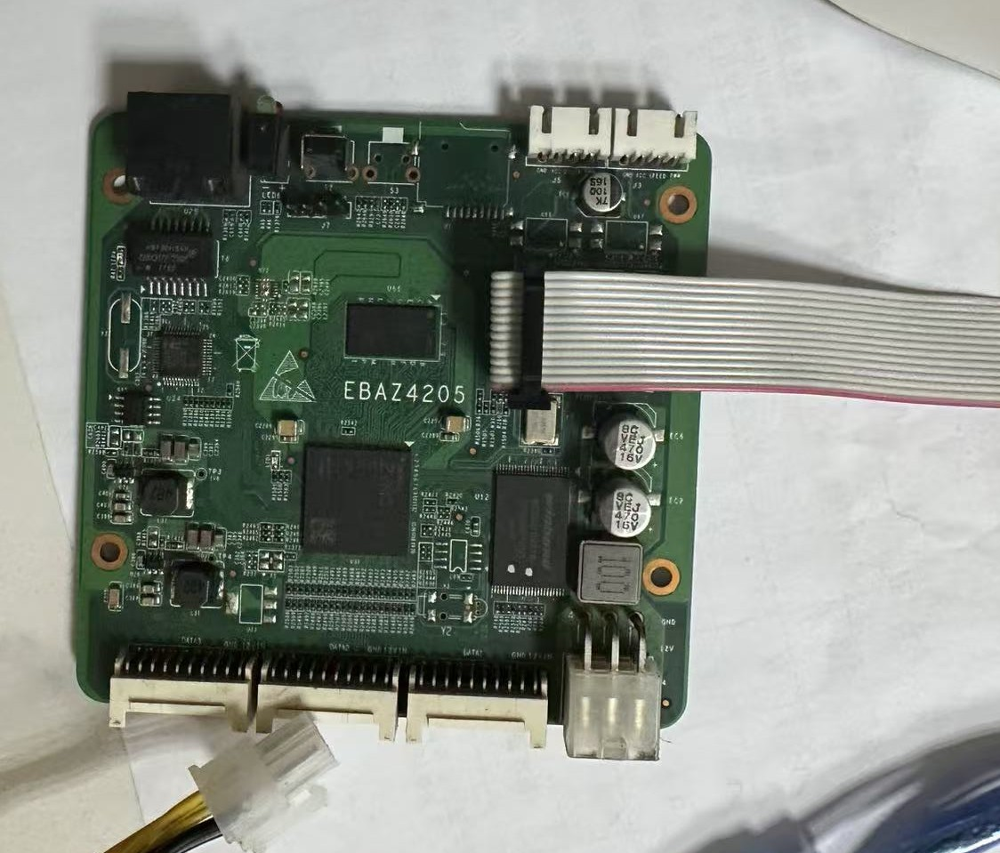

# Training 文档与接线参考

## JTAG 接线

> **注意：** 连接 JTAG 口时，`VREF`（`Verf`）必须接排线的**红色端**。

各引脚的具体配置请查看 [`traindoc.docx`](traindoc.docx) 的“学习资料”部分。

## 文件说明

| 文件 | 说明 |
| --- | --- |
| [`wiring.jpg`](wiring.jpg) | EBAZ4205 开发板 JTAG 排线接线示意 |
| [`traindoc.docx`](traindoc.docx) | Zynq 开发基础与 Shell 移植培训文档 |
| [process_chart.docx](process_chart.docx) | 嵌入式学习冲刺计划（2026-10-21 至 2026-10-31） |
| [`FormattExample.pdf`](FormattExample.pdf) | 文档格式示例 |
| [`购买参考/`](购买参考/) | 开发板及外设购买参考图片 |
