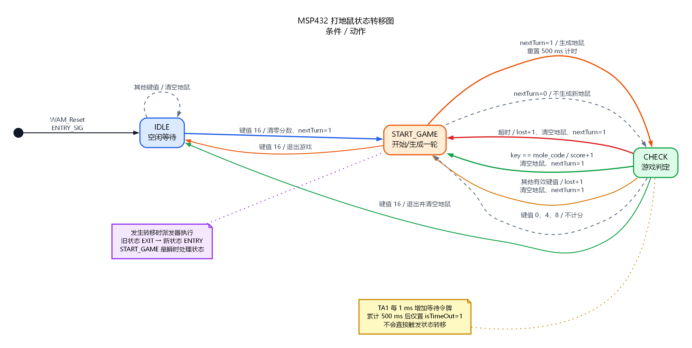

# MSP432 打地鼠 C 状态机教学工程

从 MSP432P401R 打地鼠工程中提取三状态 C 状态机，并提供可在浏览器中操作的可视化验证台、状态转移图和完整 HTML 教案。

## 状态转移图



同时提供 [SVG 矢量图](docs/whack_a_mole_state_diagram.svg)、[PNG 图片](docs/whack_a_mole_state_diagram.png) 和 [Graphviz 源文件](docs/whack_a_mole_state_diagram.dot)。

## 快速启动

在本目录执行：

```powershell
uv sync --python 3.12.12
powershell -ExecutionPolicy Bypass -File scripts/build.ps1
uv run python server.py --port 8765
```

打开：

- 实验台：<http://127.0.0.1:8765/>
- C 状态机教案：<http://127.0.0.1:8765/lesson.html>

`server.py` 会自动调用 [scripts/build.ps1](scripts/build.ps1) 重建 `build/wam.dll`，前提是 C 源码比 DLL 新。

也可以直接双击 `start-server.cmd` 启动服务。页面通过 `file://` 或非 8765
静态源打开时，会自动调用 `http://127.0.0.1:8765` 的 C 接口。

## 目录

| 路径 | 内容 |
| --- | --- |
| `original/` | 原始 Keil 工程的可构建源码快照，不含用户配置与构建产物 |
| `c/include/sol_fsm.h` | 信号、事件、返回值、处理器和基础 FSM 类型 |
| `c/src/sol_fsm.c` | 通用事件派发器与 EXIT/ENTRY 顺序 |
| `c/src/whack_a_mole.c` | `IDLE`、`START_GAME`、`CHECK` 三状态实现与主机 API |
| `c/tests/test_game.c` | C 状态、计分、超时、退出和随机确定性测试 |
| `server/` | Python 3.12.12 ctypes 桥接与本地 HTTP 服务 |
| `web/index.html` | 可操作的九宫地鼠实验台 |
| `web/lesson.html` | 四页速读 HTML 教案，覆盖 FSM、C 骨架、三状态、移植与推荐视频 |
| `design-system/` | 页面视觉设计记录 |
| `docs/` | 状态转移图及配套源文件 |

## 原状态机基线

原工程稳定状态只有三个：

1. `IDLE`：等待 MKEY 键值 16，清零记分并打开 `nextTurn`。
2. `START_GAME`：准备随机延时和地鼠；若 `nextTurn` 为假则只补循环。
3. `CHECK`：依次判断退出、超时、命中、错击，再决定是否生成下一轮。

保留的关键行为：

- 业务事件使用 `IS_GAME_SIG`。
- 500 ms 地鼠反应窗，TA1 定时器 1 ms tick。
- 生成前随机延时为 `((rand() % 15) + 5) * 100` ms。
- 九个洞映射到键盘键值 `1,2,3,5,6,7,9,10,11`。
- 键值 16 是开始/退出，键值 4 和 8 不参与命中判定。
- `nextTurn`、`isTimeOut`、得分和失分仍由 `Game_Info` 保存。

提炼时修正了四个会影响移植或测试的问题：

- 状态转移改为 `return SOL_FSM_Tran(...)`，确保派发器执行 EXIT/ENTRY。
- 按键检查只放在 `IS_GAME_SIG` 分支，不再污染生命周期信号。
- 随机源改为显式 LCG，使相同 seed 可复现。
- 无符号计分边界改为 `< 9999`，退出时立即清鼠。

详细逐行解释见 [web/lesson.html](web/lesson.html)。

教案压缩为 4 个页面区块，并包含 Quantum Leaps 的
`Modern Embedded Systems Programming Course` 播放列表链接。网页在 C 服务暂时不可用时
仍会渲染九宫盘与键盘占位，并每 2 秒自动尝试重连。

## 验证

构建 DLL 并执行 C 测试：

```powershell
powershell -ExecutionPolicy Bypass -File scripts/build.ps1
```

执行 Python/C/HTTP 联合测试：

```powershell
uv run python -m unittest discover -s tests -v
```

当前验证覆盖：

- 初始化、开始、生成、命中、错击、超时、退出。
- 键值 4 不改变当前地鼠和分数。
- 相同 seed 生成相同地鼠与准备延时。
- ctypes 能读取 C 快照与事件轨迹。
- HTTP API 与只读源码路由可用。

## API

| 方法 | 路径 | 作用 |
| --- | --- | --- |
| `GET` | `/api/state` | 读取当前 C 快照与最后一次动作事件 |
| `POST` | `/api/start` | 复位并使用键值 16 开始 |
| `POST` | `/api/press` | 向 C 发送 `{ "code": 1..16 }` |
| `POST` | `/api/tick` | 推进 `{ "elapsedMs": 0..2000 }` |
| `POST` | `/api/reset` | 复位 C 状态机 |
| `GET` | `/api/meta` | 读取洞位、键值、引脚与常量 |

网页不实现第二套游戏状态机。分数、随机、超时与迁移都由 `build/wam.dll` 提供。

## 范围

这是单用户本地教学服务，所有浏览器共用一个 C 游戏实例。主机桥接使用 Windows DLL；原始 Keil/DriverLib 工程的可构建源码保留在 `original/`。

本次验证覆盖主机 C 编译、状态机单元测试、ctypes 桥接和浏览器交互，没有向 MSP432 实物重新烧录。`WAM_Create` 动态句柄与 128 条事件日志是方便主机教学和视觉回放的适配层；若把提炼核心重新放回板端，应改为静态状态实例并按 RAM 预算裁剪事件日志。

公开版本不包含本地虚拟环境、构建输出、缓存、Keil 用户界面配置、第三方 PDF 参考资料或机器相关绝对路径。源码文件和原始文件头中的作者、版权及出处信息按原样保留。

原工程版权与衍生使用限制见 [NOTICE.md](NOTICE.md)。
