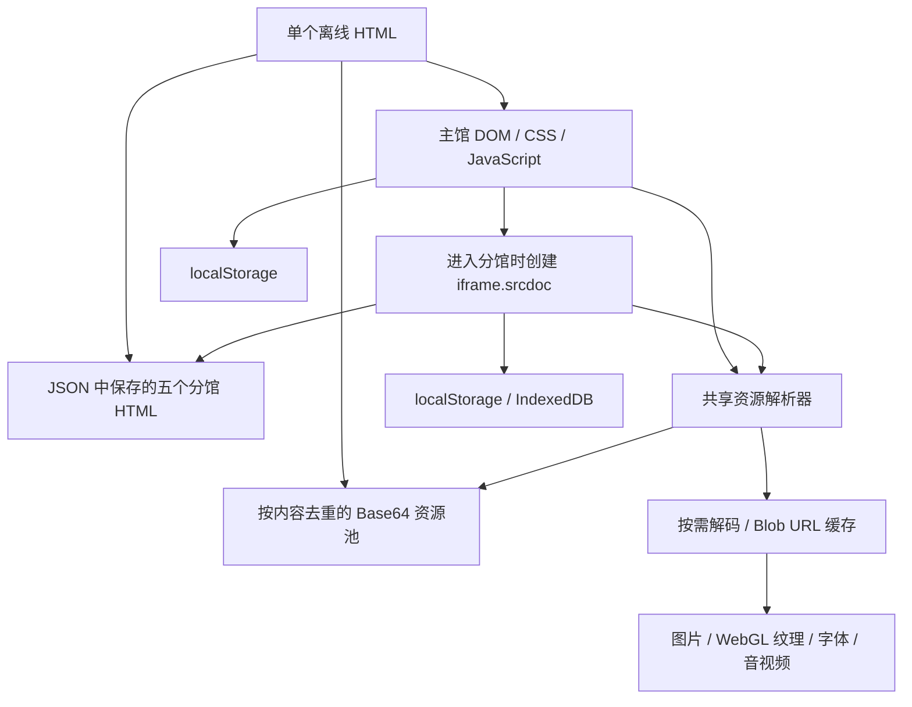

# milk-frog-museum · 奶蛙博物馆

> 本 OpenColink-Stu 源码副本按维护者要求省略了部分图片，保留上传时已经完成的图片及小型矢量图标。需要完整本地图片时，请向维护者取得原项目图片目录；图片相关检查应在资源恢复后执行。

奶蛙博物馆的全站复现与单文件离线版本，覆盖主馆和五个分馆。保留公开站点的布局、馆藏、图片、音乐和游戏交互，将登录、云端账户与付费生成流程改为本机体验。

**仓库提供源码与联网媒体版：** 下载 [奶蛙博物馆.html.gz](奶蛙博物馆.html.gz)，解压得到约 5 MB 的 `奶蛙博物馆.html`，用浏览器打开。主馆和五个分馆的代码都已内嵌，无需登录，但图片、音视频和字体仍需要联网。具体来源见下方“联网资源来自哪里”和 [资源来源说明](docs/RESOURCE_SOURCES.md)。

582 MB 的完整离线 HTML 已在本机生成并验证，按项目发布要求**没有上传到 GitHub，也没有发布离线版 Release**。仓库保留离线打包工具、资源清单与验证记录，便于研究和自行构建。

（此源码副本未附带图片：主馆）

## 包含哪些内容

| 应用 | 内容与主要交互 | 实现方式 |
| --- | --- | --- |
| 主馆 | 西方馆 114 件、中国馆 35 件；筛选、排序、分页、作品翻面、艺术家资料、双语、主题、档案、鉴定、身份证、收藏、留言和意见导出 | 原生 HTML / CSS / JavaScript，DOM 状态更新与本机存储 |
| 3D 展馆 | 40 件展品、双层展厅、走动、地图、射线查看作品及环境音 | Three.js / WebGL，代码构建几何体与场景，图片作为纹理 |
| 奶蛙小镇 | 居民、日程、生活属性、工坊、穿戴、材料、相册、手记、昼夜与旅行 | Canvas 2D 等轴投影，客户端状态模拟与 localStorage 快照 |
| 奶蛙尖塔 | 三幕爬塔、卡牌战斗、奖励、营地、图鉴、战绩和存档 | Three.js 显示，确定性随机数与阶段状态机驱动玩法 |
| 奶蛙制造所 | 头像编辑、随机搭配、PNG 下载、本地合成表情包、配文、去背景、WebM 动画与 GIF | Canvas 图层合成、IndexedDB、MediaRecorder、Web Worker 与 gifenc |
| 奶龙幸存者 | 移动、连击、战斗、成长、敌人生成与声音 | Three.js、requestAnimationFrame 游戏循环、Web Audio 和内嵌媒体 |

这些页面来源于[原站](https://neta.art/w/yizhizhi/naiwa/milk-frog-museum)。本项目是独立的复现与离线打包记录，不代表原站官方。

## 下载与使用

1. 下载仓库中的 `奶蛙博物馆.html.gz`，使用解压软件得到 `奶蛙博物馆.html`；或者按后文步骤从源码构建。
2. 在联网状态下，用支持 JavaScript、WebGL、Canvas 和音视频解码的现代浏览器打开 HTML，无需服务器或账号。
3. 主馆的“分馆”入口会在同一个文件中打开对应应用；顶部“返回博物馆”返回主馆。

`.gz` 是传输压缩，不是另一个网站版本；解压前后 HTML 内容保持一致。部分预打包页面也以 gzip 快照保存，构建器会自动读取。这使 GitHub 上传和源码分发更轻量。

本机已验证的离线构建为 **581,921,168 字节，约 582 MB / 555 MiB**。图片保留原尺寸，音视频保留原文件，因此首次打开需要解析较大的 HTML 并解码资源。手机尺寸已在 Chromium 中验证，不能据此保证所有真机、系统文件预览器、老旧浏览器或低内存设备兼容。某些手机文件预览器不执行网页脚本，应使用真正的浏览器。

身份、收藏、评论和存档保存在当前浏览器本机；它们不会跨设备同步。更换浏览器、清理网站数据、使用无痕模式或改变文件位置，可能影响本机状态的持续保存。意见箱将内容导出为 JSON，未发送邮件。媒体声音可能需要首次点击才能播放，这是浏览器的自动播放策略。

## 联网资源来自哪里

联网媒体版不会使用 GitHub 作为媒体服务器。它沿用原站公开发布物中的版本化资源 URL：

| 来源域名 | 内容 | 在项目中的用途 |
| --- | --- | --- |
| `router-files.neta.art/files/…` | Neta 托管的作品图片、首页 / 手机入口视频和部分角色参考图 | 主馆馆藏、封面、档案及入口影像 |
| `works.cohub.live/w/…/content/assets/…` | 各个作品版本目录下的图片、艺术家和原作参考图、游戏纹理、模板、音乐及字体 | 主馆与 3D 展馆、小镇、尖塔、制造所的素材 |
| `public.cohub.live/p/…/milkfrog-assets/…` | 制造所公开的头像部件库，包含表情、发型、眼镜、服装与装饰等 | Canvas 图层合成与编辑预览 |
| `fonts.googleapis.com` / `fonts.gstatic.com` | Google Fonts 样式和字体分片 | 主馆、3D 展馆和尖塔的中西文字体 |
| 页面内嵌 Base64 / Web Audio | 幸存者已内嵌的背景音乐和笑声，以及代码合成音效 | 不依赖外部媒体 URL 的游戏声音 |

这些地址来自原站公开版本，不是本项目新增的上传服务。作品外层位于 `neta.art`，实际媒体由以上 CDN 提供；本项目保留来源标识和资源清单。项目没有购买或控制这些 CDN，原站若删除文件、改变访问规则、出现防盗链 / CORS 限制或网络故障，联网版可能加载失败。

[资源来源说明](docs/RESOURCE_SOURCES.md)列出具体版本目录、字体族和如何逐项追溯。主馆的 [149 件馆藏清单](analysis/evidence/catalog-inventory.json)、[媒体清单](offline/manifest.json)、[字体清单](offline/fonts.json)和制造所的 [部件映射](reconstruction/factory/assets.json)保留了完整地址。**完整离线构建解决这些运行端联网依赖；本次公开仓库不包含它的 582 MB 成品。**

## 整体技术架构

运行端采用静态网页。主页面负责导航和本机互动，五个分馆保留独立的页面与脚本环境，通过 `iframe.srcdoc` 在进入时创建。没有运行端 Node.js 服务、远程数据库或登录 SDK。



主页面与 iframe 之间使用 `postMessage` 传递返回或切换分馆的请求；接收端核对消息是否来自当前分馆 iframe。应用代码、Three.js 等依赖都已打包进页面，不从外部 CDN 加载脚本。

## 单文件离线打包原理

### 1. 从全站代码建立资源清单

`offline/inventory.py` 从主馆 HTML 和 `localRooms` 中的五个分馆源码提取图片、音频、视频和字体地址，再合并原站的资源盘点清单。动态拼接的旅行图片、制造所模板、字体与爬塔音乐也纳入清单，避免只扫描首页时漏掉进入分馆后才使用的素材。

当前清单有 **855 个资源 URL**：633 个媒体与本地字体地址，加上 222 个 Google Fonts WOFF2 分片地址。按下载内容的 SHA-256 去重后，离线资源池有 **852 份唯一内容**。幸存者原本已内嵌的资源继续保留在分馆 HTML 内，未计入这个外部资源池数量。

### 2. 下载、断点续传和校验

`offline/download.py` 提供缓存下载；`offline/resume.py` 对未完成的文件使用 HTTP Range 续传。缓存键是 URL 的 SHA-256，元数据记录来源、MIME 类型、字节数、状态和内容 SHA-256。拒绝空文件或错误返回的 HTML，并在服务提供 Content-MD5 时核对源文件摘要。

`offline/validate-assets.py` 检查内容摘要，使用 Pillow 检查图片、检查 WOFF2 字体头，并用 ffprobe 检查音视频容器和编解码信息。下载成功不直接等同于可用素材，校验通过后才打包。

### 3. 无损压缩与字体保存

`offline/optimize.py` 尝试把 PNG 转成无损 WebP。转换前后统一为 RGBA，核对尺寸及每个像素的字节；只有结果更小且像素完全一致才使用。透明度与原图尺寸保留。当前 153 个 PNG 都得到更小的无损版本，节省约 70.7 MiB；JPEG、原 WebP 与音视频不做有损重编码。

字体 CSS 保留原有字体族、字重和 `unicode-range`，下载全部引用的 222 个 WOFF2 分片，而非只截取首页已有汉字。由此避免进入其它馆藏、游戏或编辑文字时因缺字而重新访问字体服务器。

### 4. Base64 资源池与按需 Blob URL

`offline/build.py` 将二进制写入不执行的 `<script type="application/octet-stream">` 元素，资源标识使用内容摘要。索引把原始 URL 映射到资源标识、类型和字节数。

`offline/runtime.js` 首次需要某资源时读取对应 Base64，分块解码为 `Uint8Array`，创建带正确 MIME 类型的 Blob，再生成 Blob URL。相同内容复用同一个 URL，进入不同分馆也共享父页面的资源池。Blob URL 由父页面创建，避免关闭 iframe 后缓存 URL 随子页面销毁。

这减少了重复内嵌，也避免一开始就把全部资源解码成 Blob；但原始 Base64 文本仍需由浏览器读取，且已经使用的 Blob 在本次参观期间保持缓存。因此大文件和内存开销没有完全消失。

### 5. 让原有加载逻辑读到内嵌资源

代码保留原始资源 URL 作为逻辑标识。运行时接管图片、媒体的 `src`，视频 `poster`，`setAttribute`，动态 HTML 插入，CSS `url(...)`，FontFace，Audio，fetch 与 XMLHttpRequest，将已收录资源转到 Blob URL。这也保留制造所原本依赖来源 URL 的状态和校验逻辑。

静态 HTML 解析不会经过 JavaScript 属性 setter，所以构建时将静态 `src`、`poster` 和含资源的 style 转成 `data-offline-*`，由初始化过程恢复；字体样式先以不活动的类型保存，替换 URL 后再启用。脚本执行前完成必要的资源恢复，解决初始化时序问题。

URL 解析统一处理相对路径、HTML 实体和中文文件名的百分号编码；对原有爬塔打包中重复拼接的资源前缀也进行规范化。未收录资源会记录在 `MFM_OFFLINE.missing`，不会静默回退到网络。

### 6. 用 CSP 限制运行端网络

离线页面的 Content Security Policy 允许内联脚本、样式及 Blob / Data 资源，禁止加载远程图片、字体、媒体和网络接口。字体服务器的 link / `@import` 在构建时移除。CSP 与资源解析器配合，让遗漏依赖在测试中明确暴露。

项目使用 iframe 做应用隔离，但它们没有作为不可信内容的安全沙箱：分馆需要访问父页面共享资源和通信接口。这种结构适合本项目打包的已知源码，不应直接用于运行任意第三方代码。

## 无需登录与本地创作如何实现

### 本机身份和馆藏互动

`reconstruction/local-museum.js` 替换原站身份和社交流程，用 localStorage 保存身份证、收藏、喜欢和留言；头像上传由本机 Canvas 裁切，身份证由 Canvas 绘制并导出 PNG。留言是个人设备上的记录，不会发布到原站评论区，也不具有服务端账号权限。

### 制造所的画布合成

头像使用透明图片图层叠加：背景、角色颜色、表情、头发、眼镜和装饰由状态选择，Canvas 绘制后导出 PNG。编辑历史、随机搭配与状态编码保留。图像从内嵌 Blob URL 加载，使 Canvas 可以读取像素并正常导出。

原站的付费云端 AI 被 `generation-account.mjs` 的本地适配器替代：参考图和任务保存到 IndexedDB，本地画布将头像、参考图与配文合成为预览；去背景使用简单色键，适合纯色背景，并非语义抠图模型。用户文件不上传。

**它不会运行原站的图像或视频生成模型。** 文本提示不能产生真实 AI 理解、复杂的新姿态或原站同等级的生成结果，界面已标明“本地合成 · 非 AI”。

### 视频与 GIF

动画由 requestAnimationFrame 驱动画布的旋转与位移，`canvas.captureStream()` 交给 MediaRecorder 编成约 5 秒 WebM。GIF 转换把选定片段逐帧绘制到 Canvas，读取 RGBA，交给内嵌 gifenc Worker 做调色板量化与编码；根据目标体积调整分辨率、帧率和颜色数。

离线版使用已经打包为 IIFE 的经典 Worker。测试发现 `file://` / `blob:null` 环境下的 module Worker 加载失败，改用无需模块导入的经典 Worker 后通过验证。Worker 代码与视频都在本机，导出不依赖 FFmpeg 服务或云端生成接口。

## 源码与证据目录

```text
README.md                         使用说明与技术原理
奶蛙博物馆.html.gz                联网媒体版的 gzip 快照，解压约 5 MB
reconstruction/
  build-museum.py                 构建主馆与嵌入分馆
  build-factory.mjs               Rollup 打包制造所
  local-museum.js / .css          本机互动与界面补充
  branches/*.html / *.html.gz    五个已打包的独立分馆快照
  factory/*.mjs                  制造所可编辑模块
analysis/
  奶蛙博物馆-全站分析报告.md      原站结构与实现分析
  evidence/                      公开发布物、配置与资源盘点
  branches-findings.md            五个分馆的源码证据
  identity-findings.md            原站身份流程证据
  evidence/catalog-inventory.json 149 件馆藏清单
offline/
  inventory.py / manifest.json    全站资源清单
  resume.py / download.py         缓存下载与续传
  fonts/                         字体 CSS 与下载脚本
  optimize.py                    像素一致的无损转换
  runtime.js / build.py           资源解析与单文件打包
  validate-assets.py              媒体检查
  verify-package.py               内嵌资源完整性检查
  qa/                            离线验证脚本与记录
  最终验证.json                  最终结果摘要
docs/images/                     实际离线页面截图
```

缓存、无损转换输出、巨大的完整采集记录和重复构建文件由 `.gitignore` 排除。582 MB 的离线 HTML 仅保存在本机，未发布 Release，也不写入 Git 历史；[GitHub 普通 Git 文件限制为 100 MiB](https://docs.github.com/en/repositories/working-with-files/managing-large-files/about-large-files-on-github)。完整的本机调查工作区还保留未提交的原始记录。

## 重新构建

运行最终 HTML 不需要这些依赖。修改或重新打包才需要 Python、Pillow；重新构建制造所还需要 Node.js 和 Rollup。资源检查需要 curl 与 ffprobe；浏览器验证需要 Playwright Core 和可用的 Chromium。

```bash
python3 -m venv .venv
.venv/bin/python -m pip install -r requirements.txt
npm ci
npx --no-install playwright-core install chromium

# 已打包的分馆源码直接生成联网媒体版
.venv/bin/python reconstruction/build-museum.py

# 首次建立资源缓存；恢复既有清单中的未完成资源
.venv/bin/python offline/resume.py
.venv/bin/python offline/fonts/download_fonts.py

# 校验、无损转换、打包及逐份核对
.venv/bin/python offline/validate-assets.py
.venv/bin/python offline/optimize.py
.venv/bin/python offline/build.py
.venv/bin/python offline/verify-package.py
```

输出是项目根目录的 `奶蛙博物馆-完整版离线.html`。`offline/build.py` 默认在有资源缺失时停止；`--partial` 仅供开发调试，不适合发布。下载步骤仍需要原站公开 CDN 可访问；仓库中的来源与版本化地址记录了本次快照，不保证原站永久保留它们。

修改制造所模块后先运行 `npm run build:factory`，再重新构建主馆与离线版。其它分馆当前保留预打包发布物，并非全部已还原为原作者的源工程。

### 验证修改后的版本

```bash
# 指定已有 Chromium；不指定时使用 Playwright 默认安装路径
export MFM_CHROMIUM_PATH="/path/to/chromium"
npm run verify:offline
npm run verify:mobile
npm run verify:package
```

验证脚本创建全新浏览器上下文、设置网络离线并直接打开 `file://` HTML，记录外部请求、脚本错误和缺失资源。`MFM_OFFLINE_URL` 可为手机测试指定移动或改名后的 HTML 文件 URL。原始 REA 场景记录包含当时执行环境的绝对路径，用于取证，不是跨设备直接运行的配置。

## 已验证的结果与边界

| 检查 | 结果 |
| --- | --- |
| 852 份唯一下载内容的摘要与格式检查 | 无失败 |
| 从最终 HTML 再解码 852 份资源并核对字节数与 SHA-256 | 全部一致 |
| 主馆与五个分馆，全新 Chromium、file://、网络离线 | 全部进入并执行代表性交互 |
| 收藏、留言、中国馆、3D 地图、小镇旅行、爬塔卡组、幸存者操作 | 验证通过 |
| 8 份外部音视频的浏览器元数据解码 | 全部成功；原游戏内嵌声音另保留 |
| 制造所头像 PNG 与动画 / GIF 合成 | 验证通过 |
| 手机尺寸 390 × 844：入口、菜单、作品翻面、中国馆第二页 | 验证通过，无水平溢出 |
| HTML 改名并放入无配套资源的临时目录 | 手机尺寸检查通过 |
| 外部网络请求、脚本错误、缺失资源 | 最终桌面与手机记录均为 0 |

最终 HTML 的 SHA-256：

```text
01c979fcb655334573ea2d9aa1147f4b803f3dd43459fe51117a007bfdfa4305
```

详细结果见 [最终验证](offline/最终验证.json)、[资源解码记录](offline/asset-validation.json)、[打包核对](offline/package-verification.json)、[桌面测试](offline/qa/result.json)和[手机测试](offline/qa/mobile-result.json)。截图来自实际运行：

| 3D 展馆 | 奶蛙小镇 |
| --- | --- |
| （此源码副本未附带图片：3D 展馆） | （此源码副本未附带图片：小镇） |

（此源码副本未附带图片：制造所的本地 GIF 合成）

验证覆盖代表性交互，不表示已穷举每件作品、全部关卡、所有筛选组合、长期模拟或所有浏览器。原站的服务端账户、付费生成、云端同步和后台状态没有在本项目中复现。

## 来源与授权说明

视觉素材、文字、音乐、原站发布代码及相关品牌来自原站和其依赖，权利归相应权利人。仓库公开不等同于为这些内容授予新的商业使用或再分发许可。本项目不为整个混合资源包声明统一的 MIT 等许可证；已有第三方依赖的许可与权利归属继续适用。使用、修改或分享素材前，应自行核对原始来源的授权条件。

## 开发环境与依赖恢复

在本项目目录执行开发命令。使用 Node.js 22.12+ 和 npm；保留并提交 `package-lock.json`，首次下载或同步依赖后运行 `npm ci`。不要提交 `node_modules/`。更新依赖时使用 `npm install` 并同时审阅清单和锁文件的变化。构建目录不能代替源码。

运行 `npm run build:online` / `build:offline` / `verify:package` 等调用 Python 的快捷命令前，请先激活上述虚拟环境（macOS / Linux：`source .venv/bin/activate`），确保命令中的 `python3` 使用已安装 Pillow 的环境。
