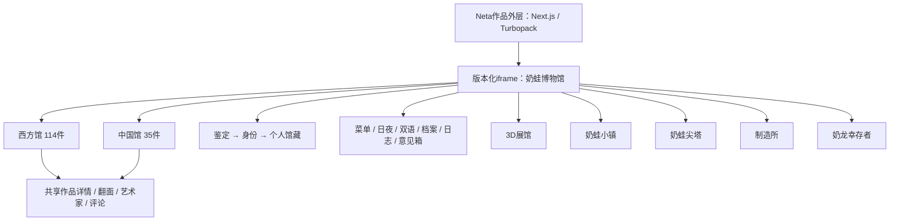

# 奶蛙博物馆：全站结构、资源与实现分析

调查日期：2026-10-13，Asia/Shanghai。目标：[用户指定的网站](https://neta.art/w/yizhizhi/naiwa/milk-frog-museum?utm_source=chatgpt.com)。

**结论：这是一个由主博物馆和五个独立分馆组成的站群。主馆包含 149 件馆藏、两套展厅、作品详情、艺术家资料、鉴定、身份、社交互动、资料档案和意见箱；五分馆分别提供 3D 漫游、小镇养成、卡牌爬塔、头像与 AI 创作、生存战斗。以下报告覆盖这些应用的公开结构和实现，明确区分完整静态盘点、代表性运行验证与未验证的服务端行为。**

没有编写或修改网站业务代码。保存的 HTML/JS/CSS 是公开发布物证据；场景 JSON 是 REA 取证输入，不是网站实现。

## 1. 调查范围与证据方法

先读取并应用本地 [REA 技能说明](/Users/wangchuanao/Programs/tools/rea/.agents/skills/reverse-engineer-anything/SKILL.md)，当前会话没有 REA MCP，因此使用 `/Users/wangchuanao/Programs/tools/rea/scripts/rea.mjs`，版本 6.3.0。采用公开 HTTP 文件、REA JavaScript 静态分析、REA Chromium 场景、DOM/无障碍树、截图、网络与 SHA-256 交叉核验。普通浏览器工具连接超时后改用 REA，没有要求用户执行命令。

本报告的“观察”指源码或运行记录直接显示；“推断”指由这些证据得到的解释；“未知”指未获得充分证据。全站范围限定于主馆可达的功能、五个明确关联分馆，以及它们的内部工作区和游戏状态，不扩展到整个 Neta 平台。

| 范围 | 覆盖结果 | 仍未验证 |
|---|---|---|
| 主馆全部馆藏与分类 | 已盘点 149 件，保存逐件名称、时期、入馆日期与图片地址 | 没有逐张下载、鉴定全部图片，也未逐一打开 149 个详情 |
| 主馆公共交互 | 桌面 34 步全部成功，含分页、筛选、翻面、艺术家、中国馆、抽屉、鉴定、主题和语言 | 所有筛选组合、键鼠与各浏览器排列未穷举 |
| 移动端 | 390×844 下入口、分页、详情轻触翻面、中国馆成功；日志与意见箱补充场景成功 | 真机触摸、coarse pointer 音效、横屏及其它尺寸 |
| 身份、收藏、喜欢、评论 | 公开发货代码的完整流程与存储、接口已分析 | 未登录、领取身份或改变公开社交数据 |
| 五个分馆 | 下载明确引用的页面、脚本、模块及配置，静态分析与代表性运行均完成 | 游戏全部关卡、长期模拟、付费生成、上传及账号同步 |

REA 的采集 `complete` 仅说明声明的动作和采集项完整，不能解释成网站所有行为均已测完。静态分析也不能证明某段代码实际执行。

## 2. 整体结构与站点边界

外层 HTML 有 `_next/static/chunks`、Turbopack 脚本和 React 服务端传输数据；外层负责作品标题、返回 Studio、登录与操作栏。其 iframe 本体为：

[主馆版本化页面](https://works.cohub.live/w/157e937b-95da-4c17-add4-f916e37c3574/milk-frog-museum/2c0b53941f17/content/index.html)。

本体是原生 HTML + CSS + `app.js` + ES module `identity-runtime.bundle.js`。未发现主馆采用 React/Vue 的实现证据；打包身份 SDK 不意味着整个主馆使用组件框架。发布版本 `2c0b53941f17`，主样式和脚本 query 为 `20260924-rococo10`，身份模块 query 为 `20260920-text-audit`。这些字符串不能单独证明作者修改时间。

主馆作品 ID 为 `1bbf7fb7-8920-45af-8481-27f4dfc7e692`，空间 ID 为 `157e937b-95da-4c17-add4-f916e37c3574`。外层声明 `space.view / session.view / file.view / file.edit / taskrun.view`；这证明发布配置里存在这些 scope，不证明当前访客已经获准读写。

iframe sandbox 明确允许脚本、同源行为、表单、弹窗、下载、模态、pointer-lock 与用户触发的顶层导航。分馆链接打开其它 Neta 作品；它们各有独立 iframe 和发布版本，不是主馆五个前端路由。

**运行边界：原始 Neta 链接在本次全新访客会话中自动出现登录层。** 没有输入账号。主馆公共交互大部分在独立 iframe URL 完成，不能据此断言身份桥接在 Neta 外层下等同于独立页面。

证据：[外层 HTML](/Users/wangchuanao/Programs/Creative/奶蛙博物馆/analysis/evidence/outer.html)、[外层运行无障碍树](/Users/wangchuanao/Programs/Creative/奶蛙博物馆/analysis/evidence/outer-settle-accessibility.txt)、E01/E02/E04。

## 3. 主馆页面与所有功能入口

| 页面 / 层 | 内容和入口 | 实现证据 |
|---|---|---|
| 移动入场 | 全屏影片、标题、进入按钮；进入后展示完整页面 | `index.html:14`；`app.js:1966`；`style.css:30` |
| 西方馆主页面 | 顶栏、影片 hero、策展序言、黑胶播放器、馆藏、五分馆、页脚 | `index.html:223–351` |
| 中国馆 | 返回西方馆、标题、三种展示顺序、分类、35件作品、分页 | `index.html:208`；`app.js:1940` |
| 作品详情 | 图像、双语名称、馆藏号、原作、艺术家、年代、介绍、鉴赏、收藏、喜欢、评论 | `index.html:353`；`app.js:1757` |
| 作品背面 | 轶事、原作参考图；桌面双击、手机单击、键盘 Enter/Space 翻面 | `app.js:1824`；`style.css:742` |
| 艺术家资料 | 仅有生平数据的艺术家名可点击；肖像、姓名、生卒年、文字 | `app.js:1860`；`index.html:480` |
| 菜单抽屉 | 分馆、夜间、语言、意见、中国馆、鉴定、身份、档案、日志，共10项 | `index.html:59–71`；`app.js:2090` |
| 奶蛙档案 | 成熟/幼态标准图、特殊动作、表情、变体、两组色谱、待归档素材 | `index.html:145–162` |
| 更新日志 | 静态日期条目、馆藏变更、功能更新；可转意见箱 | `index.html:77–124` |
| 意见箱 | 文本、附件预览/移除、提交状态 | `index.html:127`；`app.js:2053` |
| 鉴定所 | 开始 → 4题 → 加载动画 → 随机结果 → 身份领取 | `app.js:1295–1475` |
| 个人页 | 身份证、Studio ID、鉴定卡、收藏、互动、改名、退出 | `index.html:165`；身份 bundle `66,77` |
| 页脚互动 | 鼠标奶蛙拖影、笑声、提示文字；触屏采用视口定时生成 | `app.js:1576–1740` |

西方馆、中国馆、个人页在同一文档里切换 `hidden`、`body.china-view / body.profile-view`，没有各自的 URL 路由。分类、分页和详情也没有建立可分享的作品 URL；重新加载时回到初始展厅状态。图库与中国馆共用 `sortMode / activeEra / activePage`，切厅会重置分类和页码。

## 4. 全部馆藏、筛选、排序与分页

**运行 DOM 实际生成 149 个作品卡片：西方114、中国35。** 每页6件，全部分类下西方19页、中国6页；手机也仍然每页6件。源码里“desktop pagination”注释不等于移动端无限滚动。

| 西方馆时期 / 流派 | 数量 | 中国馆时期 | 数量 |
|---|---:|---|---:|
| 史前 | 6 | 史前与先秦 | 3 |
| 古典 | 8 | 秦汉 | 3 |
| 中世纪 | 6 | 魏晋南北朝 | 4 |
| 哥特 | 1 | 隋唐 | 7 |
| 文艺复兴 | 5 | 五代两宋 | 7 |
| 巴洛克 | 6 | 元明清 | 5 |
| 洛可可 | 10 | 近现代 | 6 |
| 新古典主义 | 8 | **中国合计** | **35** |
| 浪漫主义 | 14 | | |
| 现实主义 | 9 | | |
| 拉斐尔前派 | 14 | | |
| 浮世绘 | 7 | | |
| 印象派 | 8 | | |
| 后印象派 | 6 | | |
| 现代 | 6 | | |
| **西方合计** | **114** | **全馆** | **149** |

数据模型随 `app.js` 直接发布：`zh / en / url / era / orig / artist / year / story`，随后补齐 `intro / curatorial / trivia / originalImage / entryDate / acc`。中国馆先从原数组取中国作品并替换核准图 URL，再拼接补充作品；没有本次观察到的远端“馆藏搜索接口”。按标题拼接、映射和寻找作品，是当前数据组织的主要方式。

三种模式：

- **按入馆**：按 `entryDate` 字符串倒序，筛选全部、近一周、近一个月、近一年；时间依据客户端 `Date.now()`。空的时间分类会消失。本次西方馆没有“近一周”，中国馆只有“全部/近一年”，与旧入馆日期相符。
- **按年代**：艺术史大时期；多数19世纪流派映射到 `18c`。这不是按作品年份逐件数值排序，而是分类体系。
- **按流派**：西方按流派和部分时期；中国实际上按媒介/技法：陶器青铜、三彩、雕塑、壁画石刻、工笔、写意、其它，分类主要用中文标题正则匹配。

“推荐”是排序入口，所有作品仍保留，馆长指定名称优先，其余按入馆日期排序，不是筛出固定6件。分页全部在浏览器内进行：先创建所有卡片，再用 `.hide` 控制6件显示；`loading=lazy`和 IntersectionObserver 帮助图片与入场动画。

馆藏号按时期递增，如 `MFM · REN-01`。它们是前端派生编号，不是已确认的数据库主键。`ERA_ORDER / ERA_CODE / ERA_LABEL` 没有完整包含哥特，相关作品会走排序/编号/文案兜底，这是代码可见的分类一致性问题。

证据：`app.js:80,97,773,967,981,1035–1259`；E02运行DOM；[149件逐项清单](/Users/wangchuanao/Programs/Creative/奶蛙博物馆/analysis/evidence/catalog-inventory.json)。清单包括图片源，不只有第一页作品。

## 5. 视觉、布局、动效和资源

实际效果是白色与米纸色大留白、深蓝标题、金色细线、衬线大标题。字体声明为 Cormorant Garamond、Jost、Noto Serif SC，并提供宋体/PingFang等系统回退。夜间模式使用接近黑色背景、米白字和金色线条。

CSS前部有旧固定顶栏规则，但后部 `style.css:423` 覆盖为130px高的相对定位顶栏。不能把最先搜到的 `position:fixed` 认作当前效果。桌面 hero 左右52px留边、高度接近视窗；≤1024px两列图库，≤720px顶栏76px、hero转16:9、卡片简化、过滤条横向滚动；还有390px及560px细化规则。

动效包括 hero 缓慢缩放、卡片视口渐入、抽屉水平滑动、模态遮罩、作品 `rotateY(180deg)` 翻面、个人页分段淡入、手机760ms影片退出。部分效果支持 `prefers-reduced-motion`；本次手机验证只设置窄视口，未模拟真实触屏指针，因此不把它当作所有触摸行为的证明。

资源盘点从三份发布文本提取 **372个去重媒体路径/URL字面量**，其中218个相对路径、154个远端地址。此数字是“声明引用数”，包括备用、旧数据和隐藏状态资源，不是网络下载数或必然使用数。

| 资源组 | 盘点内容 | 加载/使用方式 |
|---|---|---|
| 馆藏图像 | 当前149个卡片各自图片地址 | 多为 `router-files.neta.art`；少量 `public.cohub.run` |
| `assets/context/` | 171个本地引用 | 原作参考、艺术家等；其中存在旧/备用引用 |
| `assets/quiz/` | 30张鉴定结果图片 | 当前随机结果池 |
| `assets/archive-references/` | 7张本地图片，另有远端标准/色谱图 | 档案抽屉 |
| `assets/hover-frogs/` | 4张透明图 | 页脚彩蛋 |
| 视频 | `assets/hero.mp4` + 手机远端影片 + poster | 首屏视觉独立于背景音乐 |
| 音频 | museum-bgm、waltz-no19、frog-hover，共3个本地MP3 | 两首BGM轮换、笑声覆盖 |
| 黑胶与头像 | turntable.webp、代码生成头像/Studio头像 | 播放器和身份区 |

`Audio` 与 `<video>`分离；BGM循环、音量0.28，笑声音量0.42并暂停BGM，最后一个笑声结束再恢复。浏览器手势解锁失败会回退静音；实际可听音量没有在本次工具环境测量。静态HTML曲目计数是01/01，运行代码更新为01/02，以运行结果为准。

公开 CSS、`app.js`和身份 bundle 在初次运行捕获里的SHA-256与静态下载完全一致。HTML digest不同，运行响应和DOM显示平台注入了 `__cohub/runtime.js`与统计脚本；因此保留两个HTML表示，没有伪称其字节一致。[摘要核验记录](/Users/wangchuanao/Programs/Creative/奶蛙博物馆/analysis/evidence/runtime-static-digests.json)。

[媒体路径清单](/Users/wangchuanao/Programs/Creative/奶蛙博物馆/analysis/evidence/media-manifest.json)保留原始文件及行号。[网络记录](/Users/wangchuanao/Programs/Creative/奶蛙博物馆/analysis/evidence/runtime-network.json)是观察窗口内实际请求，两者不可混同。未对所有媒体进行全量下载或体积加总。

## 6. 鉴定、身份、个人页与社交实现

**鉴定并不根据答案判定类型。** 四题答案只push进数组；`analyse()`随机选30只之一并避开上一只，1700ms后显示结果。星级另随机：3星50%、4星38%、5星12%；编号和评语也随机。两次独立场景选相同选项得到了不同奶蛙，支持源码结论。

结果页提供8个开放头像和Studio头像，昵称最多24字。代码中虽有16个头像名，实际 `slice(0,8)`，没有“另外8个靠积分解锁”的证据。点击“进入博物馆”需Studio身份，签发前端 `ID-1000…9999`展示号，UUID才是登录账号标识。原有Canvas导出PNG代码仍在`app.js`，但正常加载的身份模块以捕获监听拦截结果按钮，转到领取身份流程；不能因日志写“可保存”就认为当前按钮仍下载PNG。

本地状态 `identity / spec / favorites` 存 `mfm-visitor-identity-v2:<userUuid>`。收藏仅存作品名称与URL，未发现它通过公共社交文件跨设备同步。个人页从这些状态渲染身份、鉴定卡、收藏和互动；无身份时个人入口转鉴定。桌面“重新鉴定”在≤720px改为“鉴定卡”；退出奶蛙身份不等于登出Studio或删掉公开评论。

公共社交是空间文件 `data/milk-frog-social-v1.json`，结构为 `works[workName].likes/comments`：

| 行为 | 实现 | 验证边界 |
|---|---|---|
| 喜欢 | 匿名浏览器ID，`mfm-anonymous-like-id-v1`；不调用业务登录流程 | 能否匿名写入由平台授权决定，未实际点赞 |
| 收藏 | 需Studio和本地身份证，本地favorites数组切换 | 未登录收藏，无跨设备验证 |
| 评论 | 需身份；非空、≤240个JS字符；同UUID全馆15秒一次；每作品最多100条未移除评论 | 客户端规则不能证明服务端也强制 |
| 删除/举报 | 本人软删除；不同UUID举报达到3个直接移除 | 没有已证实的馆长复核后台链路 |
| 同步 | 打开详情读文件、20秒刷新；整文件写回，expected mtimeMs/size乐观检查，最多4次重试 | 没有实际并发写成功记录 |

SDK接口涉及 `/api/users/profiles/batch`、空间`fs/file`的GET/PUT，iframe通过parent `postMessage`取得context/授权。独立页面采用popup broker。直接本体运行的详情明确提示“请从 Studio 页面打开，查看公开评论和点赞”，因此独立页面里看到0不能证明公共数据为空。

完整函数定位、存储键、授权及并发边界见 [身份与互动专项证据](/Users/wangchuanao/Programs/Creative/奶蛙博物馆/analysis/identity-findings.md)。未发现主馆业务积分、签到、成就、兑换逻辑；SDK里有通用billing API并不证明本站使用。

## 7. 意见箱、档案、日志与内容差异

意见箱是multipart表单发往FormSubmit的馆长邮箱，target为隐藏iframe。附件跨选择累计、按name/size/lastModified去重，最多6个、单个10MiB、总计20MiB；有预览和移除。至少需要非空意见，未设置意见文本长度上限。仅`accept`提示类型，提交代码未再次验证后缀/MIME。

提交之后，只要iframe触发load就清空表单并显示已投递；代码没有读取成功回执。这种UI不能证明邮箱送达。调查没有发送意见或上传文件。（`index.html:131–140`；`app.js:2053–2089`）

档案是静态视觉规范资料：成熟/幼态体型、绿色眼环与短嘴线、标准视图、动作与表情、形象与色彩变体。当前透明底图等“待归档”文案不代表已有下载功能。

日志是HTML静态内容，既非动态CMS接口，也不保证完全反映当前实现。最新条目提“全馆123件”，实际当前DOM149件；历史宏伟/战争展区说明也没有对应当前独立分类入口，不能只读日志就认定仍有单独页面。

双语切换只覆盖部分界面。英文作品介绍、鉴赏、轶事及艺术家生平在代码里大量使用通用英文模板，不是完整逐篇译文；过滤按钮更新读`dataset.era`，创建时却写`dataset.filter`，加上重新render卡片未完整保留语言处理，说明“切英文后继续筛选”的一致性存在静态疑点，未对所有路径复测。（`app.js:1741–1754,1867,1889–1933`）

## 8. 已确认的移动端功能差异

≤720px时 `.menu-trigger{display:none!important}`；顶部`themeToggle/langToggle/feedbackTopToggle`在各宽度也被隐藏。桌面通过菜单可切主题、语言和档案；手机菜单入口同时消失，三个功能缺少当前可见入口。

这有运行证据：手机无障碍树没有“打开菜单”，末步点击隐藏菜单超时；此前8个步骤已成功，不能把该超时描述为整页无法使用。手机仍有鉴定、日志、个人页和hero里的中国馆；日志中的意见按钮可打开意见箱，补充场景4步全部成功。分馆可在页面下方进入。

证据：`style.css:435,486–495`；E03/E06；[手机界面记录](/Users/wangchuanao/Programs/Creative/奶蛙博物馆/analysis/evidence/mobile-china-back-accessibility.txt)。

## 9. 五个分馆的完整结构与实现

下文附入五分馆调查全文，包含各自内部工作区、玩法、资源和运行边界。它们采用各自数据与存储键；主馆149件不能直接等同于3D馆的40件，两者内容量与展示逻辑不同。

### REA 与证据覆盖

静态 REA Evidence ID：`ev_1c1ba6213b7637a19c230ff012c2918aaa9abbc1f817946c1f98c2eb8e6a4fc3`；输出 `analysis/evidence/branches-static-rea.json`。分析范围为已下载公开 HTML、JS/MJS、CSS及明确引用JSON，包含五分馆外壳 HTML；REA 并未执行这些文本、不能证明静态分支已发生。动态 bundle 符号压缩、资源动态拼接、第三方SDK及服务器实现存在未解析项。

- gallery：`ev_1cb787f66e7a18278e70aee0dadcb2ea5a39448cad4893a08f421b8776a4314e`；`4`个动作全部 completed；采集完整性 `incomplete`；本次 page-error `0`；网络请求 `76`。场景/完整证据/截图在 `analysis/evidence/branches/gallery/`。
- town：`ev_3171e66171aea297bcb808c0fc429bc335c644b9d8593b41989792ab0c85c476`；`6`个动作全部 completed；采集完整性 `complete`；本次 page-error `0`；网络请求 `37`。场景/完整证据/截图在 `analysis/evidence/branches/town/`。
- tower：`ev_05a167f4a43791c943fea058f50cc76b278800f9caa50db63d2b91b931aec4b3`；`4`个动作全部 completed；采集完整性 `complete`；本次 page-error `0`；网络请求 `66`。场景/完整证据/截图在 `analysis/evidence/branches/tower/`。
- factory：`ev_0070013b3464d5c5b35d9b5656927fdbc29121639772656985beb4c4ae9dc01d`；`6`个动作全部 completed；采集完整性 `complete`；本次 page-error `0`；网络请求 `173`。场景/完整证据/截图在 `analysis/evidence/branches/factory/`。
- survivor：`ev_31b59f74235d0392c3aa5ba57d54490b60992fb928017e470d4ab59c5124c3ee`；`3`个动作全部 completed；采集完整性 `complete`；本次 page-error `0`；网络请求 `15`。场景/完整证据/截图在 `analysis/evidence/branches/survivor/`。

五分馆场景均有第三方统计请求关闭/采集结束时中止，不能等同业务失败。3D馆背景音频请求在截取结束时仍未完成，使其REA事件覆盖标记 incomplete；其四个操作仍全部 completed。幸存者还有默认favicon 404。

### 1. 3D 展馆

- 外壳地址：[3D展馆页面](https://neta.art/w/6f97ac11-95f5-451f-b4c6-214c3f02668a)。inner 地址见 `gallery/inner.url`，版本 `ba518f92d4d0`。
- 结构：序厅进入按钮 → WebGL漫游 → 两层切换 → 地图/作品详情/声音/清涂鸦工具栏；触屏有摇杆、查看、投掷按钮。HTML明确1F西方24件、2F中国16件（`gallery/index.html:55–56`）。
- 实现：原生IIFE、独立 `app.js`+`style.css`、vendor Three.js；相机、灯、走廊、画框、长椅、文物、访客和奶蛙以代码创建，而图片作为画面纹理。`ARTWORKS`集中存图名、原作信息、描述、房间和位置。`buildMuseum/buildFloor`搭场景，`switchFloor`切层，`inspectAt`射线查看，`updateMovement`移动。证据 `gallery/app.js:4,230,276,309,385,1063,1084,1130,1150`。
- 额外交互：游走访客/奶蛙、隐藏奶蛙、彩蛋连投、颜料溅射、命中奶蛙发笑；`createSculptureCollection`含铜奔马、方尊、宫灯、跪射俑等4类造型，`createHiddenFrogs`放隐藏角色（`:495–558,655–777,1187–1360`）。
- 运行观察：序厅进入、地图打开关闭、中国二层切换成功。截图 `gallery/gallery-4.png`可见两层按钮、中国绘画走廊、访客和奶蛙。全部40幅逐件查看、彩蛋物理、长时漫游及声音播放未逐个动态验证。

### 2. 奶蛙小镇 · 奶白广场

- 外壳：[分馆页面](https://neta.art/w/337d4274-ff22-43c7-9e3c-7f03e58766e8)。版本 `502d979a5c76`。
- 结构：Canvas广场、3个居民、手记侧栏五页（居民/属性/工坊/相册/手记）、1×/2×/4×模拟速度、暂停、出门旅行；属性含日程、性格、生活状态、职业天赋与解锁；工坊含奶币、穿戴、制作、小卖部、材料、纪念品和物件摆放。证据 `town/index.html:17–29`。
- 实现：`app.js` UI/Canvas2D渲染+`town.js` Town状态模拟；背景、前后朝向奶蛙、纪念品等为本地png/webp；projectPoint/unproject完成等轴画面与点击坐标换算；Canvas排序绘制遮挡、季节天气和昼夜光照。证据 `town/app.js:11–12,50,209,520–579,1290`。
- 模拟与数据：1游戏日120模拟秒，季节7天；6基础属性及5生活状态、buff/debuff、关怀、装备、合成、旅行材料和纪念品、技能成长及职业解锁。`town/town.js:130–139,244–284,336–338,453–568,727–796,899`。
- 记忆与对白：使用本地字符哈希向量+cosine，权重含重要度与时间衰减，固定话库随机拼接；每人最多60条记忆；每日剧情也用本地模板汇总最近记录。这不是已证实的远端大模型agent。证据 `town/town.js:18–38,1161–1171,1481–1548`；小镇脚本无fetch/SDK/API调用，仍不能据此断言Neta外壳无网络。
- 保存：`localStorage["naiwa-town-v1"]`存Town.snapshot（`:2881–2890`）；旅行/互动照片由Canvas本地合成并下载（`app.js:263–364,1474–1505`）。
- 运行观察：五页切换、出门旅行面板成功，截图 `town/town-6.png`。未长时运行全部季节、技能解锁或旅行归来，不声称模拟平衡或存档迁移已验证。

### 3. 奶蛙尖塔 · The Soft Ascent

- 外壳：[分馆页面](https://neta.art/w/c659fde8-8117-4fc4-82ed-751c781308c4)。版本 `bae45df10a91`。
- 结构：营地/图鉴/战绩/存档，开局装备（弹力反击、毒与续航、轻身连打）、进阶挑战、种子输入→路线节点→回合卡牌战斗→奖励/休息/商店/随机事件/宝箱→三幕Boss/结局。CSS/JS是带hash的构建产物，HTML只有5个容器。证据 `tower/index.html:3–6`、`tower/assets/index-Dw7dlT3i.js`。
- 实现：打包Three.js WebGL渲染与Lucide图标，游戏逻辑为客户端确定性seed/rngState及状态转换；phase含map,battle,reward,rest,shop,event,treasure,bossReward,won,lost。默认80生命99金币、每回合3能量；战斗包含抽/弃/消耗牌堆、格挡、弹力、强壮、虚弱、易伤、中毒、荆棘、遗物/药水。三幕各9层，第三幕Boss后won。
- 资源：`assets/美术资源.json`纹理清单，角色idle/attack/hit/defend/cast精灵图，Three Sprite按帧更新；音乐/音效本地资源。
- 存档：`milk-frog-campaign-v1`为营地+run，兼容`milk-frog-spire-v1`；导入校验4MB上限、整体替换、不合并奖励，保存导入前备份；损坏存档可开临时不保存旅程。源码有验证器而非只存UI。
- 运行观察：向上出发后DOM `data-phase="map"`，查看牌组弹窗关闭成功。截图起始营地 `tower/scenario_start.png`；注意即时截图可能在异步状态提交绘制前一帧，状态以同一步DOM/后续截图为准。未通关三幕、验证全部卡牌combo/导入损坏分支。
- 证据定位：bundle为压缩长行，不用推测原源码模块名；可按 `function gr`, `function zt`, `function xu`, `window.__frogGame`, `milk-frog-campaign-v1`, `const Ar`, `function jd`, `function nf`搜索找到上述对应逻辑。

### 4. 奶蛙制造所

- 外壳：[分馆页面](https://neta.art/w/8a36fbe6-51f2-4ad9-9f28-46f933f756b1)。版本 `8c27a0f17a88`。
- 三工作区：捏奶蛙、变成奶蛙、表情包。手动支持风格、配色、微调、贴纸、锁定随机、撤销重做、方圆预览、1024×1024 PNG及小尺寸预览。支持发型染色、服饰/头饰/背饰、表情、纹身上传、细节参数等独立模块。证据 `factory/index.html:28–97`、`app.mjs:1–7`、`state.mjs`、`hair-studio.mjs`、`wardrobe.mjs`、`tattoo.mjs`。
- 手动原理：`art.mjs`读取`assets.json`公开Cohub图片清单，按状态用Canvas叠合头像；`state.mjs`校验编码、随机、历史及版本迁移；`app.mjs`本地保存 `milkfrog.avatar.v9`并兼容v1–v8、URL hash分享编码状态。分享地址硬编码 `https://cohub.live/atou/milkfrog/w/milkfrog#frog=...`，不等于主馆地址。
- AI玩法：变成奶蛙/今日状态/和你一对/戴点我的，另有确认后细修；参考图转PNG、上传个人授权space、prompt+base64参考+原味奶蛙图，调用 `gpt-image-2.5`、1024×1024、high质量；返回单张sheet裁为四个头像，配对时合成对图，并保存manifest/outputs至空间。证据 `generation.mjs:136–173,222–274,276–316`、`generation-prompt.mjs`、`refinement.mjs`。这些模型字符串仅证明前端请求配置，不证明服务端真实模型供应商或能力。
- Cohub对接：动态import `@neta-art/cohub@8.13.0`，scopes `file.view/file.edit/generation.create/taskrun.view/user.space.list`；检查空间归属与账号切换，借SDK授权context/spaces/files/generations。下载头像也要求Neta app ID匹配与fresh token/登录。证据 `generation-account.mjs:1–90`、`download.mjs:1–30`。
- 长任务：sessionStorage保留job taskRunId，pending/submitting/saved/failed区分；重复提交被拦；不明确提交结果时要求先核对任务，避免重复扣费；结果轮询、错误余额不足单独处理。`generation.mjs:19–25,276–314`。
- 表情包：1/4/9张sheet、最多16参考图，每张可设角色/动作/梗构图/画风/服饰/背景及作用范围；配文、本地caption、透明背景另计费birefnet-general；可生成视频后选段转GIF，整套ZIP借fflate；IndexedDB保留job/refs/tiles/video，按owner隔离。证据 `memes.mjs:25–59`、`meme-core.mjs`、`meme-media.mjs`、`meme-download.mjs`。
- 运行观察：捏头像微调/贴纸、AI工作区/配对、表情包工坊全部可打开，公开图片成功显示，截图 `factory/factory-6.png`。未登录授权、上传、扣费生成/去背景/视频、保存空间、真正下载验证，因此账号与外部服务结果仅为静态流程证据。

### 5. 奶龙幸存者 · 割草

- 外壳：[分馆页面](https://neta.art/w/68438093-6659-4747-87b7-4d8e47dc093b)。版本 `a0938fb1141a`。
- 结构：选择剑客或加特林→3D俯视生存→经验升级选强化→死亡重开/换角色；键盘WASD/J/左鼠标/Space/K/Shift，触屏虚拟摇杆+攻击/冲刺/跳跃。暂停/继续、生命/经验/武器/击杀/Boss栏。证据 `survivor/index.html:87–115`。
- 实现：单文件约50万字符HTML，inline module通过importmap加载 unpkg Three.js 0.160.0；角色/奶龙/地面/树石/枪剑等由代码几何体构造，BGM与笑声为内嵌base64音频、战斗SFX为WebAudio合成。原始HTML为证据；提取 `inline-1.js`仅用于静态索引，非开发新应用。
- 性能：InstancedMesh合批、对象池、敌人/粒子/GIB上限、远距剔除；触屏省电档关阴影、降低分辨率、最多60fps/特效减半。证据 `survivor/inline-1.js:6–23,188–242,335,510–528,886`。
- 规则：小/胖/坦克/Boss4类；敌人生命和速度随分钟成长，45秒群刷；首Boss阈值60秒，后续最多cap存活及动态间隔；Boss践踏/冲刺/召唤/激光，剑连击/空中坠地重斩，加特林瞄准自动扫射、穿透/散射/爆裂弹强化；XP到阈值暂停选强化，HP≤0结束。证据 `inline-1.js:323–377,420–438,623–718,729–850,997–1005,1050–1069`。
- 运行观察：剑客进入、Esc暂停成功，截图 `survivor/survivor-pause.png`；未长时运行到Boss或全部升级。只在这份源码内未见持久存档、排行榜或胜利条件，不能外推平台所有功能。

### 无法确定的共同部分

- 本调查可以解释公开发货前端及代表性运行轨迹，不拥有作者工程、构建配置、未公开版本历史、服务端数据库或SDK内部实现。
- 动态采集是独立inner站点临时浏览器，不能据此断言嵌在Neta外壳时的账号握手、iframe权限/跨域消息完全相同。
- 场景采集complete仅表示所声明采集动作完整，不代表五个游戏全部内容、所有设备和长期行为完整。
- 媒体清单和运行网络已覆盖公开引用，但未下载全部图片/音乐/视频作归档；不能据公开链接断言作品授权、来源或作者身份。
- 五分馆皆位于同一works.cohub.live origin，版本目录不同；代码本地存储键也不同。是否有平台自动跨版本/跨设备同步，源码与本次未登录场景不足以确认。

### 补充覆盖与站群边界复核

- 逐一检查五分馆 HTML/本地JS中的锚点、new URL、window.open与location赋值，未发现第六个新奶蛙应用入口。制造所页脚回主馆链接UUID `1bbf7fb7-8920-45af-8481-27f4dfc7e692`与主馆外壳 cohubWorkId 一致；其余4条为已调查分馆。
- 制造所分享目标 `https://cohub.live/atou/milkfrog/w/milkfrog`读取HTTP 200，页面元数据与hydration数据明确 `app.id=8a36fbe6-51f2-4ad9-9f28-46f933f756b1`、`spaceId=5990ff16-a7fb-4bcf-91fe-66eb8206d499`，图标指向相同发布版本 `8c27a0f17a88`，故属制造所Cohub别名，不是新增分馆。证据 `factory/share-target.html`与headers。
- 制造所 `assets.json`列110个唯一公开Cohub图像URL，分表情/发型/服饰/背景/角色细节等；资源清单完整保留，但未逐个下载归档。
- 尖塔美术清单包含model标签 `gpt-image-2.5`、pipelineHash、partial=false、逐动作sourceSHA256/sha256、角色/环境。元数据说明作者资源流水线标注，并不独立证明实际生成供应商。
- 表情视频请求配置为 `minimax-h3-max-turbo`，duration=5、resolution=768P，默认循环时首尾使用相同图片；GIF由本地视频帧提取/编码，支持起终秒、速度与往返。证据 `factory/memes.mjs:58–60`，未真实调用视频服务。

- tower扩展REA：`ev_b31343633b54341f45abaff03114162924e1e5acf69481a3d6a5d5f34e6893ce`，声明12个动作全部completed、无page-error；完整性`incomplete`，结束时未完成请求路径：['/w/a3c46aa6-ce65-4cf7-9d69-3d564bdb7f5a/milk-frog-spire/bae45df10a91/content/assets/sprites/mist_wisp/defend.webp']。

- factory扩展REA：`ev_a5f0fbb957d4fcc881addc8ebfdd33b9bf82028b85f85ab4d1ec40c59e3a8452`，声明8个动作全部completed、无page-error；完整性`incomplete`，结束时未完成请求为111项公开素材读取，原始路径保留在分馆完整REA记录中；不代表这些图片永久不可用。

- 尖塔扩展动态覆盖营地→图鉴→战绩→存档→营地→出发→路线→第一场战斗→牌组弹窗→结束回合按钮。截图 `tower/expanded-camp-collection.png`、`tower/expanded-camp-history.png`、`tower/expanded-camp-backup.png`、`tower/expanded-battle-ready.png`、`tower/expanded-end-turn.png`。结束回合处理含async动画，即时截帧可能仍显示第1回合，所以只能证实点击处理与场景进入，不将该帧当作第2回合数值证据。
- 制造所扩展动态覆盖手动微调/贴纸→变成奶蛙→今日状态→和你一对→戴点我的→表情包。各配置表单与素材可见，未触发连接、授权或生成。截图 `factory/expanded-mode-emotions.png`、`factory/expanded-mode-pairs.png`、`factory/expanded-mode-wear.png`。

[查看 gallery 的采集场景与文件目录](/Users/wangchuanao/Programs/Creative/奶蛙博物馆/analysis/evidence/branches/gallery/scenario.json)。

[查看 town 的采集场景与文件目录](/Users/wangchuanao/Programs/Creative/奶蛙博物馆/analysis/evidence/branches/town/scenario.json)。

[查看 tower 的采集场景与文件目录](/Users/wangchuanao/Programs/Creative/奶蛙博物馆/analysis/evidence/branches/tower/scenario.json)。

[查看 factory 的采集场景与文件目录](/Users/wangchuanao/Programs/Creative/奶蛙博物馆/analysis/evidence/branches/factory/scenario.json)。

[查看 survivor 的采集场景与文件目录](/Users/wangchuanao/Programs/Creative/奶蛙博物馆/analysis/evidence/branches/survivor/scenario.json)。

## 10. 无法确定的部分与结论限度

1. 作者原始工程、构建设置、未公开资源、完整版本历史、服务端代码与数据库没有取得；公开文件足以解释前端，但不能重建所有平台内部逻辑。
2. 未登录及未执行公开写入：身份签发、收藏、点赞、评论、删除、举报的成功和权限只能按源码说明；也未验证跨设备账号状态。
3. 制造所的模型名、scopes、计费提示和轮询来自前端配置；没有实际生成、扣费、上传、透明背景/视频/GIF结果，不证明服务端使用何种真实模型。
4. 游戏已盘点阶段、规则和资源并验证代表性入口；未穷举全部卡牌、Boss、升级、地图事件、季节、旅行结果或长期存档行为。
5. 图片、视频与音乐地址可公开引用不证明作者身份、原始创作方式、版权许可、全部资源始终可访问。
6. 原始Neta外层在新会话显示登录层；独立iframe运行不能代替外层账号桥接测试。未读取用户真实token、cookie或本地账号数据。
7. REA静态主馆应用盘点完整、无解析失败，但语义图达到100000节点上限，语义覆盖为partial，留有30930个保守未知项；没有将其解释成30930个网站缺陷。
8. 初次就绪检查使用了匹配149中114个卡片的非唯一选择器，REA严格模式报错；后续34步采用唯一目标并全部通过。该初始失败证据保留，不充当功能失败结论。
9. 外层和若干媒体/统计请求在采集结束时仍未完成或中止，因此部分REA结果标为incomplete。没有把转场即时截图里的空白或未完成请求判为资源永久缺失。

## 11. 证据索引

| 编号 | Evidence ID | 文件 / 核心用途 |
|---|---|---|
| E01 | `ev_58c4adb93006f957d1d453a02ad75e931c4e2274e9dad288ae762343ef852f88` | [主馆静态完整证据](/Users/wangchuanao/Programs/Creative/奶蛙博物馆/analysis/evidence/rea-static.json)；2份JS+HTML，47项静态发现；[摘要](/Users/wangchuanao/Programs/Creative/奶蛙博物馆/analysis/evidence/rea-static-summary.json) |
| E02 | `ev_370f78047e311edfbb7ee75fcfd61c791773298d98d5986398740454c81bbe5e` | [34步桌面场景](/Users/wangchuanao/Programs/Creative/奶蛙博物馆/analysis/evidence/rea-interactions.json)，complete，无page-error |
| E03 | `ev_7c65e5322a68d16dbaadb546b6fd4330a24ee8169f80701f23dc4799f9ca1315` | [手机场景](/Users/wangchuanao/Programs/Creative/奶蛙博物馆/analysis/evidence/rea-mobile.json)，8步成功，隐藏菜单失败，incomplete |
| E04 | `ev_cf9c5331f28a937e1179ff2a44146fa6259e218e75f262cec53ad446adc09673` | [Neta原始链接场景](/Users/wangchuanao/Programs/Creative/奶蛙博物馆/analysis/evidence/rea-outer.json)，登录层；网络事件未完全结束 |
| E05 | `ev_3107eca494413973c50d788e0f713a8d7efa9118dc03739aedae19f7cc939f43` | [稳定中国馆及第二次鉴定](/Users/wangchuanao/Programs/Creative/奶蛙博物馆/analysis/evidence/rea-settled.json)，10步，complete |
| E06 | `ev_4eadccb9cc1abb6de60938db265a84aa1edd196088a9b96be26e568a47ec2dda` | [手机日志/意见入口](/Users/wangchuanao/Programs/Creative/奶蛙博物馆/analysis/evidence/rea-mobile-extra.json)，4步，complete |
| E07 | `ev_810612188843c2ce3b82a23df7df3cbec0369ccbef72636c1d89cac225e097c6` | [首次网络内容抓取](/Users/wangchuanao/Programs/Creative/奶蛙博物馆/analysis/evidence/rea-desktop.json)，包含精确脚本字节及初次非唯一就绪选择器失败 |

五分馆各自静态/运行Evidence ID见第9节和 [分馆专项报告](/Users/wangchuanao/Programs/Creative/奶蛙博物馆/analysis/branches-findings.md)。文件、字节摘要、原始来源和场景都保留，便于追查每项结论。

主馆原始文件：[HTML](/Users/wangchuanao/Programs/Creative/奶蛙博物馆/analysis/evidence/site/index.html)、[app.js](/Users/wangchuanao/Programs/Creative/奶蛙博物馆/analysis/evidence/site/app.js)、[style.css](/Users/wangchuanao/Programs/Creative/奶蛙博物馆/analysis/evidence/site/style.css)、[身份模块](/Users/wangchuanao/Programs/Creative/奶蛙博物馆/analysis/evidence/site/identity-runtime.bundle.js)。

## 12. 代表性运行截图

以下均是目标真实运行截图，未生成或重绘网站。

主馆影片首屏：

中国馆稳定显示：

作品详情：

鉴定结果与身份领取：

手机入馆后：

原始Neta链接的登录层：

### 分馆运行截图

3D展馆：中国二层：

小镇：旅行与手记：

尖塔：第一场卡牌战斗：

制造所：戴点我的工作区：

幸存者：已进入游戏并暂停：

## 附录：全部149件馆藏名称

### 西方馆 · 史前（6件）

巨石阵黎明奶蛙；阿尔塔米拉的奶蛙；岩画手印奶蛙；塞拉山奔跑奶蛙；石阵仪式奶蛙；岩刻游行奶蛙。

### 西方馆 · 古典（8件）

萨莫色雷斯的胜利女神奶蛙；休息的拳击手奶蛙；拉奥孔群像奶蛙；汉谟拉比法典石碑奶蛙；第一门的奥古斯都奶蛙；纳芙蒂蒂头像奶蛙；德尔斐御者奶蛙；米洛斯的奶蛙。

### 西方馆 · 中世纪（6件）

乔托哀悼基督奶蛙；契马布埃圣三位一体圣母子奶蛙；乔托逃往埃及奶蛙；杜乔进入耶路撒冷奶蛙；圣乔治屠龙奶蛙；圣母子与奶蛙。

### 西方馆 · 哥特（1件）

哥特奶蛙圣母院。

### 西方馆 · 文艺复兴（5件）

雪中猎人奶蛙；大使们奶蛙；最后的晚餐奶蛙；创造奶蛙；雅典学院的核心奶蛙。

### 西方馆 · 巴洛克（6件）

浪子回头奶蛙；以马忤斯的晚餐奶蛙；绘画的艺术奶蛙；布商同业公会理事奶蛙；绘画寓意的自画像奶蛙；油灯前的抹大拉奶蛙。

### 西方馆 · 洛可可（10件）

秋千奶蛙；画家与她的女儿奶蛙；读书少女奶蛙；拿陀螺的男孩奶蛙；小丑吉尔奶蛙；梅兹坦奶蛙；破壶奶蛙；肥皂泡奶蛙；门闩奶蛙；跳舞的卡玛戈奶蛙。

### 西方馆 · 新古典主义（8件）

雷卡米埃夫人奶蛙；翻越阿尔卑斯奶蛙；苏格拉底之死奶蛙；荷拉斯兄弟之誓奶蛙；贝尔坦先生奶蛙；视察雅法疫病院奶蛙；贝利撒留受施奶蛙；马拉之死奶蛙。

### 西方馆 · 浪漫主义（14件）

1808年5月3日奶蛙；望月的两人奶蛙；海洋边的僧侣奶蛙；吕根岛白垩崖奶蛙；吉萨的狮身人面像奶蛙；卢浮宫废墟的想象图奶蛙；纳尔尼桥奶蛙；墓园孤儿奶蛙；雾海上的旅人奶蛙；但丁之舟奶蛙；梦魇奶蛙；干草车奶蛙；梅杜萨之筏奶蛙；自由引导人民奶蛙。

### 西方馆 · 现实主义（9件）

吹笛少年奶蛙；前线的俘虏奶蛙；巴拉克拉瓦奶蛙；拾穗者奶蛙；石工奶蛙；伏尔加河上的纤夫奶蛙；三等车厢奶蛙；晚钟奶蛙；抢球奶蛙。

### 西方馆 · 拉斐尔前派（14件）

罗利的童年奶蛙；奥菲莉亚奶蛙；贝娅塔·贝亚特丽克斯奶蛙；水晶球奶蛙；看哪，主的婢女奶蛙；圣西塞莉亚奶蛙；玫瑰之魂奶蛙；圣巴塞洛缪节前夕的胡格诺派奶蛙；废墟中的爱奶蛙；释放令，1746奶蛙；蓝色凉亭奶蛙；夏洛特夫人奶蛙；普罗塞耳皮娜奶蛙；金色阶梯奶蛙。

### 西方馆 · 浮世绘（7件）

甲州石班泽奶蛙；大桥安宅骤雨奶蛙；三代目大谷鬼次奶蛙；泷夜叉姬与骷髅妖怪奶蛙；金太郎捕鲤鱼奶蛙；神奈川冲浪奶蛙；雪中桥奶蛙。

### 西方馆 · 印象派（8件）

包厢奶蛙；布吉瓦尔之舞奶蛙；伞奶蛙；蓝色扶手椅上的小女孩奶蛙；雨天的巴黎街道奶蛙；睡莲中的奶蛙；撑阳伞的奶蛙；干草堆奶蛙。

### 西方馆 · 后印象派（6件）

大碗岛的星期天下午奶蛙；罗纳河上的星夜奶蛙；玩纸牌的奶蛙；星月奶蛙夜；向日葵奶蛙；圣维克多山奶蛙。

### 西方馆 · 现代（6件）

沉睡的吉普赛人奶蛙；夜游者奶蛙；阿黛尔的肖像奶蛙；构成八号奶蛙；三个音乐家奶蛙；呐喊的奶蛙。

### 中国馆 · 史前与先秦（3件）

新石器彩陶纹样奶蛙；神人兽面纹玉琮奶蛙；四羊方尊奶蛙。

### 中国馆 · 秦汉（3件）

秦始皇陵跪射俑奶蛙；长信宫灯奶蛙；击鼓说唱俑奶蛙。

### 中国馆 · 魏晋南北朝（4件）

洛神赋图奶蛙；云冈石窟北魏佛像奶蛙；竹林七贤与荣启期砖画奶蛙；女史箴图奶蛙（工笔）。

### 中国馆 · 隋唐（7件）

唐三彩骆驼载乐俑奶蛙；游春图奶蛙；簪花仕女图奶蛙；捣练图奶蛙（红衣小孩转化版）；照夜白图奶蛙（骑马版）；虢国夫人游春图奶蛙（骑行者转化工笔版）；步辇图奶蛙（红衣人物转化工笔版）。

### 中国馆 · 五代两宋（7件）

韩熙载夜宴图奶蛙；定窑白釉孩儿枕奶蛙；清明上河图奶蛙；寒江独钓图奶蛙（写意）；芙蓉锦鸡图奶蛙（枝条角落版）；早春图奶蛙（山石笔墨融合版）；万壑松风图奶蛙（山石笔墨版）。

### 中国馆 · 元明清（5件）

富春山居图奶蛙；百骏图奶蛙；荷花与鸭奶蛙（写意）；梅花图奶蛙（写意梅枝版）；桃源仙境图奶蛙（人物转化工笔版）。

### 中国馆 · 近现代（6件）

奔马奶蛙（变体形态版）；虾趣奶蛙；蛙声十里出山泉奶蛙；万山红遍奶蛙；江山如此多娇奶蛙；鹰石山花奶蛙。

